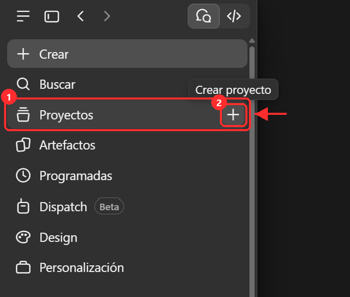
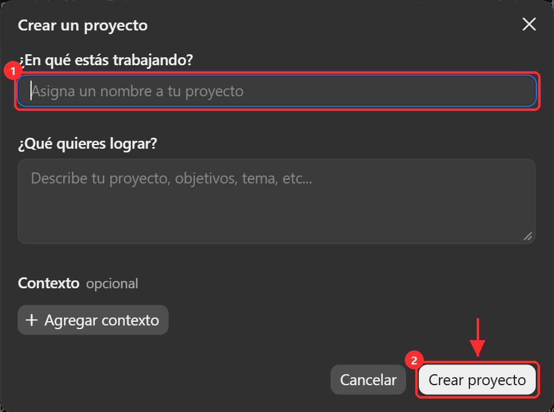
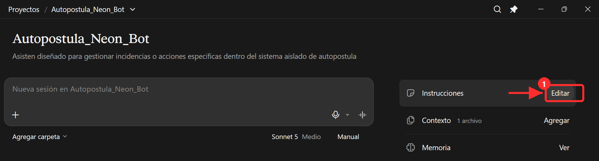
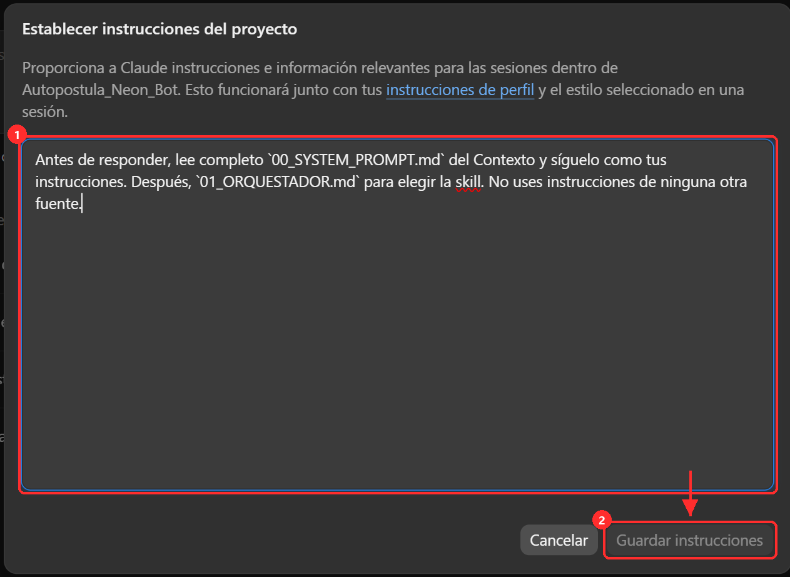
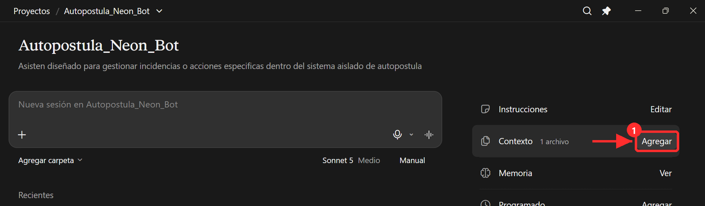
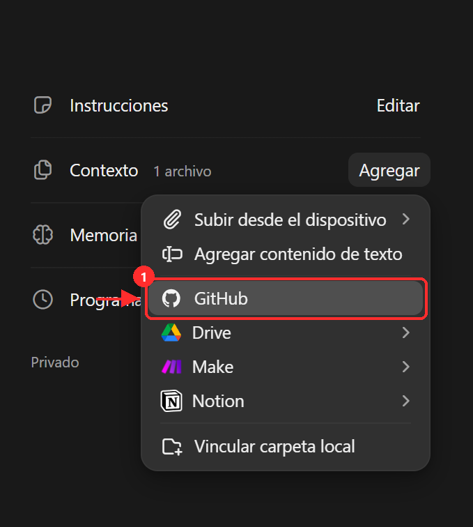
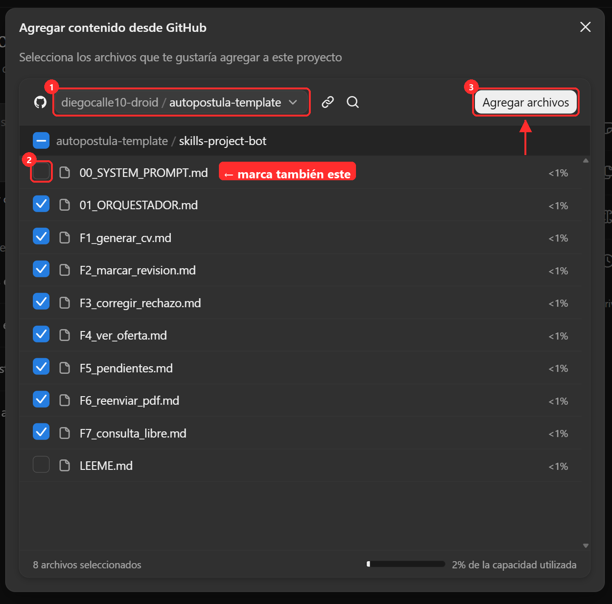
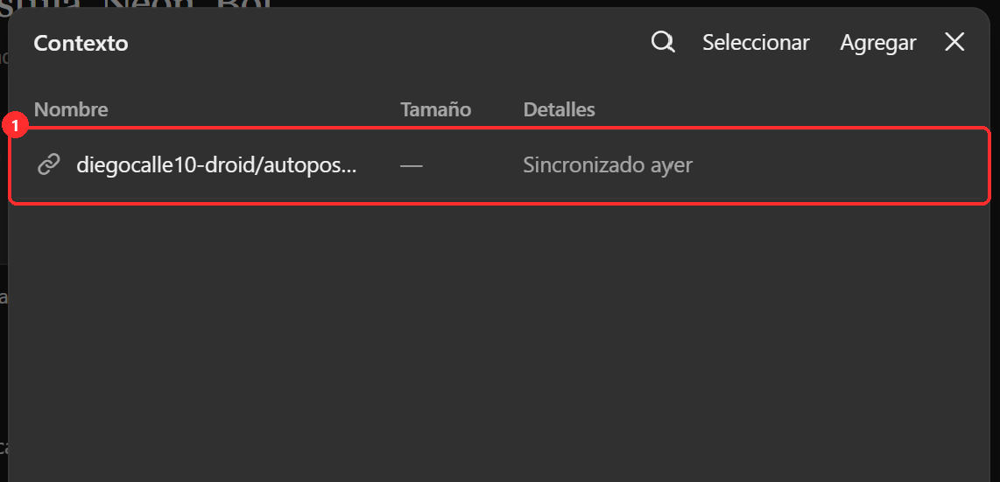
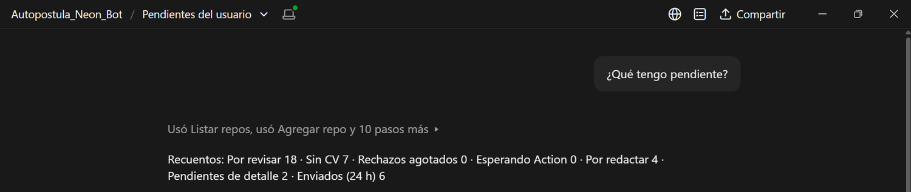

# Bot de gestión (opcional)

Un Project de Claude para manejar tus ofertas hablando, desde el móvil o el ordenador: «¿qué tengo pendiente?», «marca la 4012 como apta», «genérame el CV de esta oferta», «reenvíame el PDF». Qué archivo va en cada sitio: `skills-project-bot/LEEME.md`; aquí, dónde hacer clic.

Antes: el conector de Neon (`guia/conector-neon.md`) y tener el repositorio al día en GitHub.

## 1. Crear el Project

1. En el menú de la izquierda, entra en **Proyectos** y pulsa **+** (1), o **Nuevo proyecto**.

   

2. Ponle nombre `Autopostula_Neon_Bot` (1) y pulsa **Crear proyecto** (2). El resto es opcional.

   

## 2. Instrucciones

1. En el Project, pulsa **Editar** (1) en **Instrucciones**.

   

2. Pega solo la frase de `skills-project-bot/LEEME.md` (paso 2) y pulsa **Guardar instrucciones**.

   

## 3. Contexto: los archivos del bot

1. En **Contexto**, pulsa **Agregar**.

   

2. Elige **GitHub**.

   

3. Elige tu repositorio (1) y entra en la carpeta `skills-project-bot`. Marca `00_SYSTEM_PROMPT.md` (2), `01_ORQUESTADOR.md` y `F1` … `F7`: 9 archivos (en la captura falta marcar el `00_SYSTEM_PROMPT.md`). `LEEME.md` no hace falta. Pulsa **Agregar archivos** (3).

   

4. En el Contexto aparece tu repositorio, sincronizado desde GitHub.

   

## 4. Conectores

En el chat del Project, activa los conectores **NEON_MCP** y **GitHub** (en el menú **+** de la caja de mensaje).

## 5. Prueba

Pregunta «¿Qué tengo pendiente?». Debe responder con los recuentos de tu base y la lista de lo que necesita tu decisión.

*(La captura es de otra instalación: tus números serán los tuyos.)*
