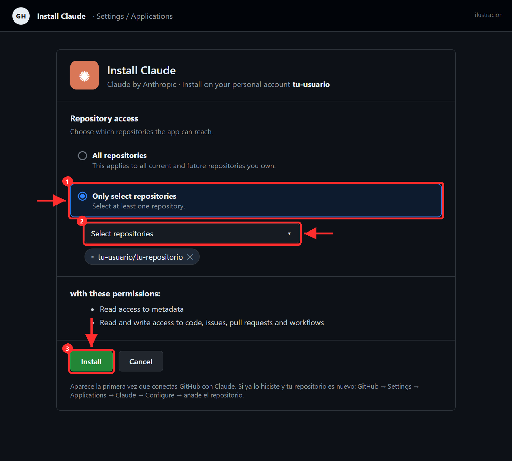
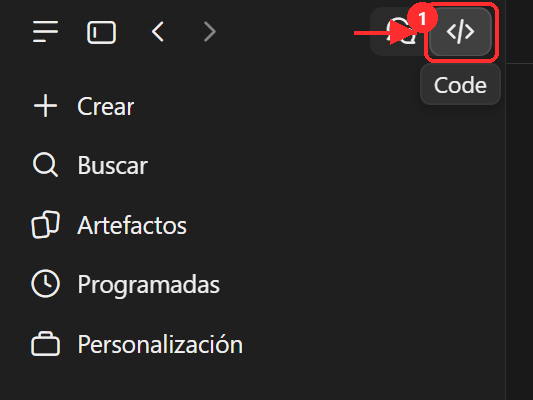
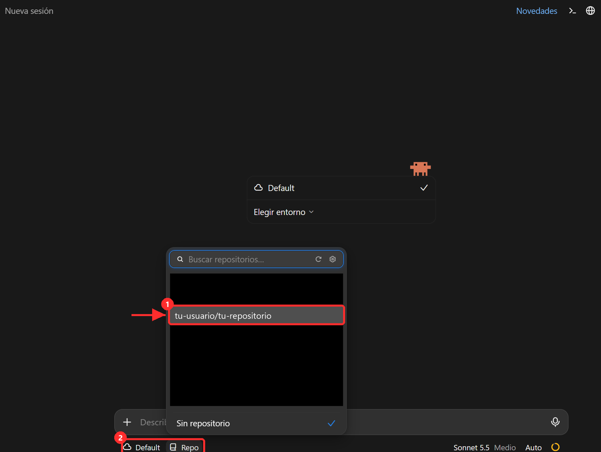
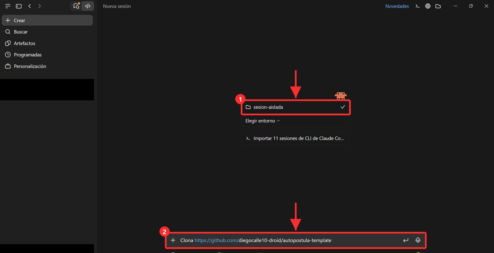
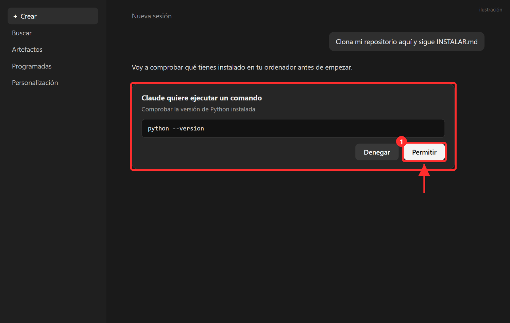

# Claude Code: abrir tu repositorio

Claude Code es la parte de Claude que trabaja con archivos y comandos. Lo usas dos veces: para la entrevista (en la nube, sin instalar nada) y para instalar en tu PC. Viene incluido en Claude Pro. Las dos veces se hace desde la app de escritorio de Claude (claude.ai/download) o desde claude.ai/code.

## A. La entrevista (en la nube)

### 1. Conecta GitHub (solo la primera vez)

Al elegir un repositorio por primera vez, Claude te pide conectar GitHub. Acepta: GitHub abre la página de instalación de la app de Claude.

1. En **Repository access** elige **Only select repositories**.
2. Abre el desplegable **Select repositories** y marca tu repositorio privado de Autopostula (también vale **All repositories**).
3. Pulsa **Install**.

*(Ilustración: GitHub puede cambiar el diseño de esta página, pero los tres pasos son los mismos.)*

Si ya habías instalado la app y tu repositorio es nuevo, no te aparecerá en la lista: GitHub → **Settings** → **Applications** → **Claude** → **Configure** → añade el repositorio.

### 2. Abre una sesión y elige tu repositorio

1. En la app, abre la pestaña **Code** (el botón `</>` de arriba a la izquierda).

   

2. En **Nueva sesión**, deja el entorno en la nube (**Default**, 2 en la captura), pulsa **Repo** y elige tu repositorio de la lista (1).

   

3. Escribe **«configura mi Autopostula»** y sigue la entrevista. Para adjuntar tu CV en PDF, usa el **+** de la caja de mensaje.

## B. La instalación en tu PC

1. Abre otra vez la pestaña **Code** y pulsa **Crear**.
2. Elige como carpeta de trabajo una carpeta vacía de tu PC, por ejemplo `Documentos\Autopostula` (1 en la captura).
3. Escribe: **«Clona https://github.com/&lt;tu-usuario&gt;/&lt;tu-repositorio&gt; aquí y sigue INSTALAR.md»** (2 en la captura) y pulsa Intro.

   

   *(En la captura la carpeta se llama `sesion-aislada` y el repositorio es el de la plantilla; en el tuyo serán los tuyos.)*

4. Claude te pedirá permiso antes de ejecutar comandos o cambiar ajustes de tu PC: lee lo que va a hacer y pulsa **Permitir**. Si algo no lo entiendes, pulsa **Denegar** y pregúntale.

   

   *(Ilustración: el texto exacto del aviso puede variar.)*
