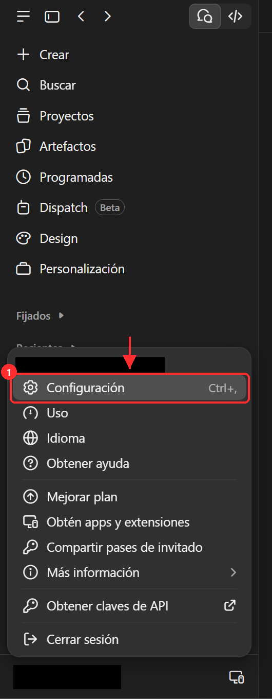
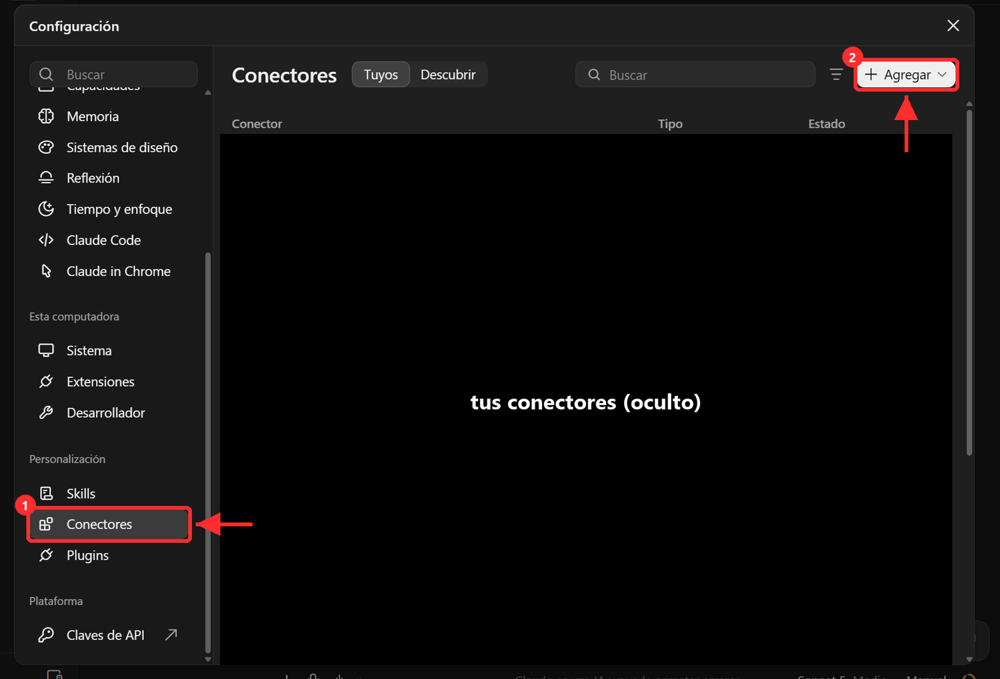
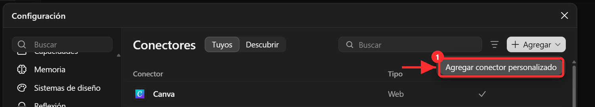

# Conector de Neon en Claude

La rutina de CV y el bot de gestión leen y escriben en tu base a través de un conector de Neon. Se conecta una vez y vale para los dos.

1. Abre el menú de tu cuenta (abajo a la izquierda de la app) y pulsa **Configuración**.

   

2. En el menú de la izquierda, entra en **Conectores** (1) y pulsa **Agregar** (2).

   

   *(En la captura la lista de tus conectores está tapada.)*

3. Elige **Agregar conector personalizado**.

   

4. Rellena el formulario:
   - **Nombre**: `NEON_MCP` (con ese nombre lo verás en la rutina).
   - **URL**: `https://mcp.neon.tech/mcp`
   - Pulsa **Agregar**.
5. Neon abre una ventana para iniciar sesión y autorizar a Claude: usa la misma cuenta del proyecto `autopostula` y acepta. Si te deja elegir proyectos, elige el tuyo o «todos».
6. De vuelta en Conectores, `NEON_MCP` aparece en la lista como conectado.
