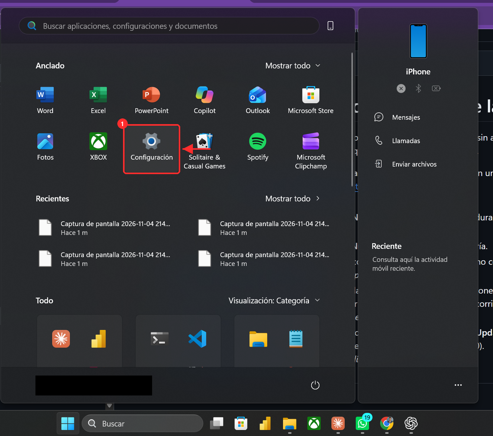
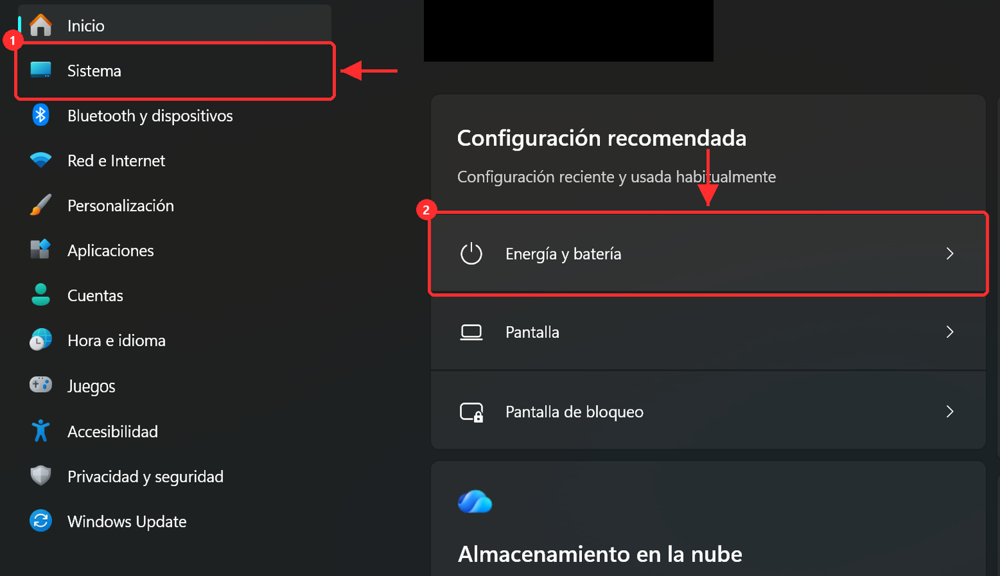
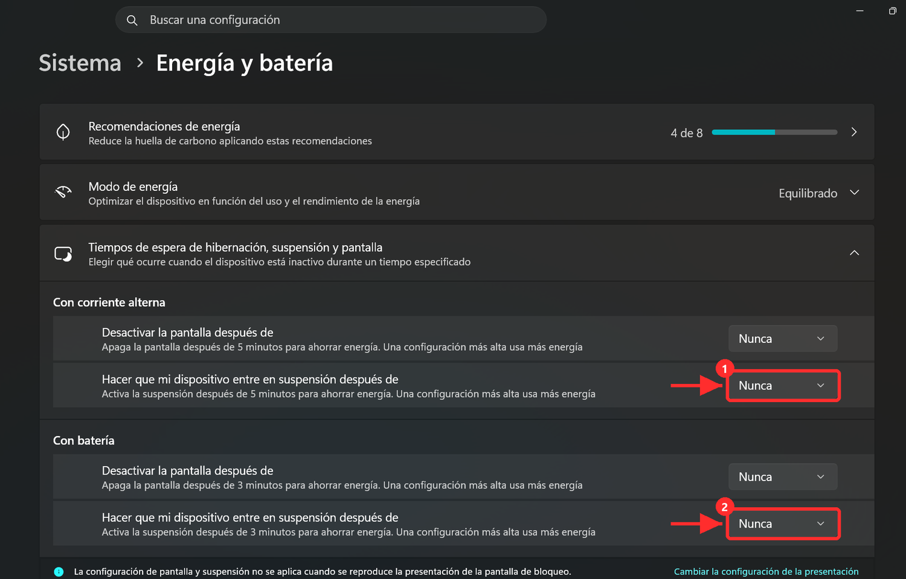

# Windows: que el PC no se duerma durante la captura

La captura dura varias horas de noche. Si Windows suspende o hiberna el PC, se corta sin avisar. Al terminar, la captura apaga el PC sola unos minutos después, así que no se queda encendido toda la noche.

1. Abre **Configuración**: menú Inicio (tecla Windows) y el icono de **Configuración**.

   

2. En **Sistema** (1) entra en **Energía y batería** (2).

   

3. Abre **Tiempos de espera de hibernación, suspensión y pantalla** y pon **Hacer que mi dispositivo entre en suspensión después de** en **Nunca**, tanto **con corriente alterna** (con cargador, 1) como **con batería** (2). Si aparece **Hibernar**, también en **Nunca**. La pantalla sí puede apagarse: no corta la captura.

   

4. **Portátil:** déjalo enchufado. Si quieres poder cerrar la tapa: Panel de control → Opciones de energía → **Elegir el comportamiento del cierre de la tapa** → «Al cerrar la tapa»: **No hacer nada** (con corriente).
5. **Windows Update:** para que no reinicie de madrugada, abre Configuración → **Windows Update** → **Opciones avanzadas** → **Horas activas** y ajústalas para que cubran la noche (por ejemplo, de 22:00 a 08:00).
