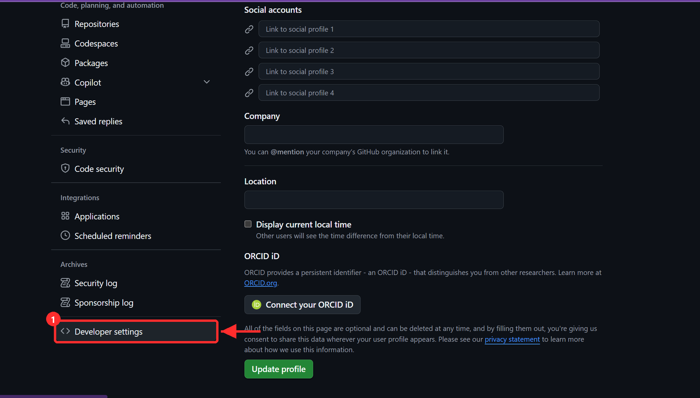
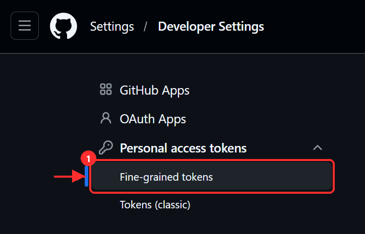
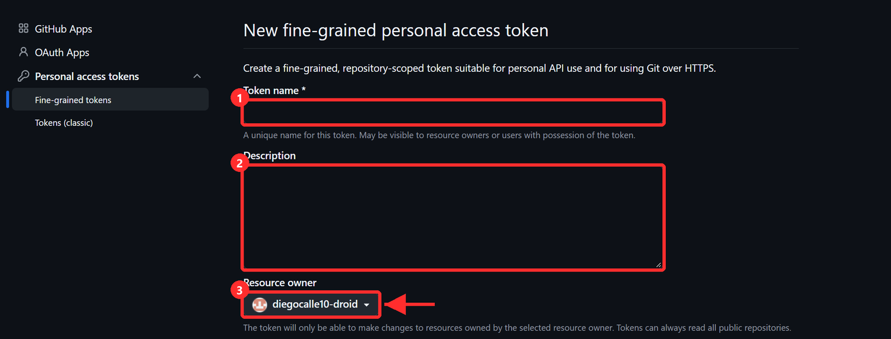

# GitHub: secretos de la Action y token de la rutina

## Secretos

La Action «CV a PDF» corre en GitHub y necesita tres datos de tu `.env`. Con la GitHub CLI, Claude los sube con `gh secret set -f .env` y no tienes que hacer nada. A mano:

1. Abre tu repositorio en GitHub y entra en **Settings** (arriba, a la derecha de Insights).

   

2. En el menú de la izquierda, **Secrets and variables** (1) → **Actions** (2).

   

3. Pulsa **New repository secret** y crea uno por cada uno de estos, con el nombre exacto y el valor de tu `.env`:
   - `NEON_DATABASE_URL`
   - `TELEGRAM_BOT_TOKEN`
   - `TELEGRAM_CHAT_ID`

   Escribe el nombre en **Name** (1), pega el valor en **Secret** (2) y pulsa **Add secret** (3).

   

4. Al terminar, la lista muestra los tres nombres (los valores no se ven nunca más).

## Token para la rutina

La rutina de CV, al acabar, avisa a la Action para que genere y envíe los PDF. Para eso necesita un token con permiso solo sobre tu repositorio.

1. Pulsa tu foto (arriba a la derecha) → **Settings**.

   

2. Baja hasta el final del menú de la izquierda y entra en **Developer settings**.

   

3. **Personal access tokens** → **Fine-grained tokens**, y pulsa **Generate new token**.

   

4. Rellena el formulario:
   - **Token name** (1): `autopostula-rutina`. **Description** (2): opcional.
   - **Resource owner** (3): tu cuenta.
   - **Expiration**: que **no caduque** (**No expiration**) si GitHub te deja; si no, la fecha más lejana posible, y nunca menos de 3 meses. Cuando un token caduca, la rutina deja de avisar a la Action y los CV no llegan: apunta la fecha para renovarlo.
   - **Repository access**: **Only select repositories** y elige tu repositorio de Autopostula.
   - **Permissions** → **Repository permissions** → **Actions**: **Read and write**. Nada más.

   

5. Pulsa **Generate token** y cópialo: solo se muestra una vez. Guárdalo para la rutina (`guia/rutina.md`); no lo pegues en ningún chat.
