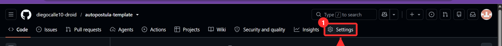
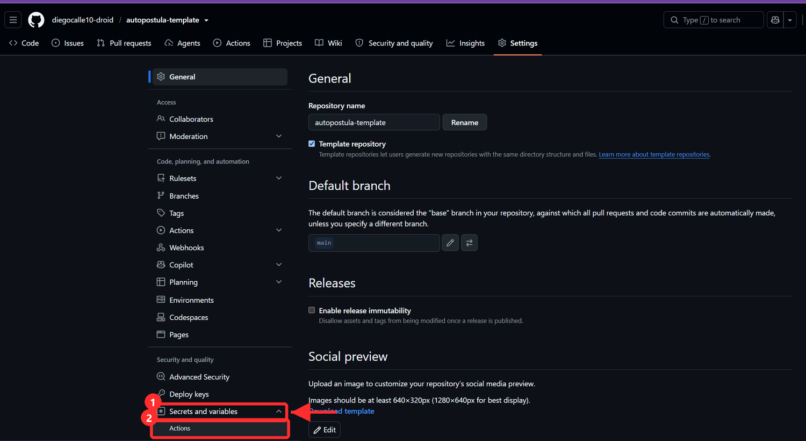
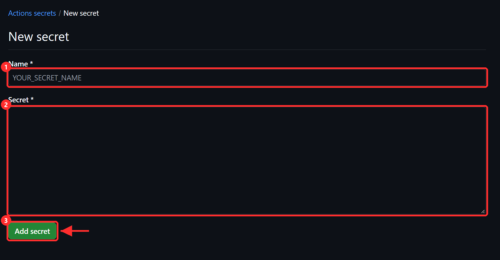
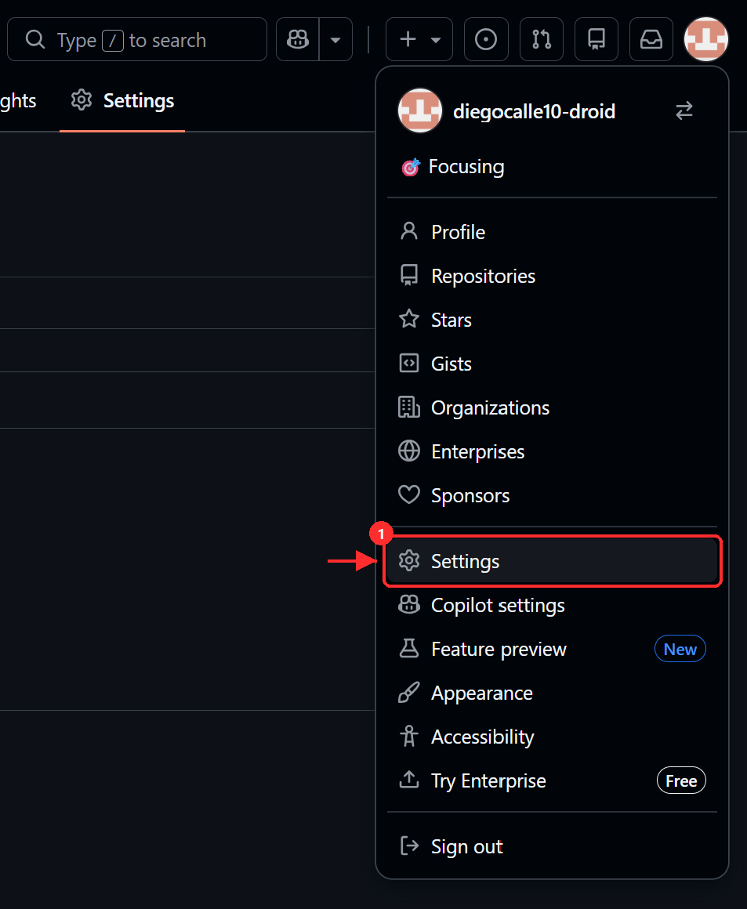

# GitHub: secretos de la Action y token de la rutina

## Secretos

La Action «CV a PDF» corre en GitHub y necesita tres datos de tu `.env`. Con la GitHub CLI, Claude los sube con `gh secret set -f .env` y no tienes que hacer nada. A mano:

1. En tu repositorio: **Settings** → **Secrets and variables** → **Actions**.
    *(captura pendiente)*
2. **New repository secret**, una vez por cada uno, con el nombre exacto y el valor de tu `.env`:
   - `NEON_DATABASE_URL`
   - `TELEGRAM_BOT_TOKEN`
   - `TELEGRAM_CHAT_ID`
    *(captura pendiente)*
3. Al terminar, la lista muestra los tres nombres (los valores no se ven nunca más).

## Token

La rutina de CV, al acabar, avisa a la Action para que genere y envíe los PDF. Para eso necesita un token con permiso solo sobre tu repositorio.

1. GitHub → tu foto → **Settings** → **Developer settings** → **Personal access tokens** → **Fine-grained tokens** → **Generate new token**.
    *(captura pendiente)*
2. Nombre: `autopostula-rutina`. Caducidad: la más larga que te permita (cuando caduque, crea otro y cámbialo en la rutina).
3. **Repository access**: **Only select repositories** → tu repositorio de Autopostula.
4. **Permissions** → **Repository permissions** → **Actions**: **Read and write**. Nada más.
    *(captura pendiente)*
5. **Generate token** y cópialo: solo se muestra una vez. Guárdalo para la rutina (`guia/rutina.md`); no lo pegues en ningún chat.
