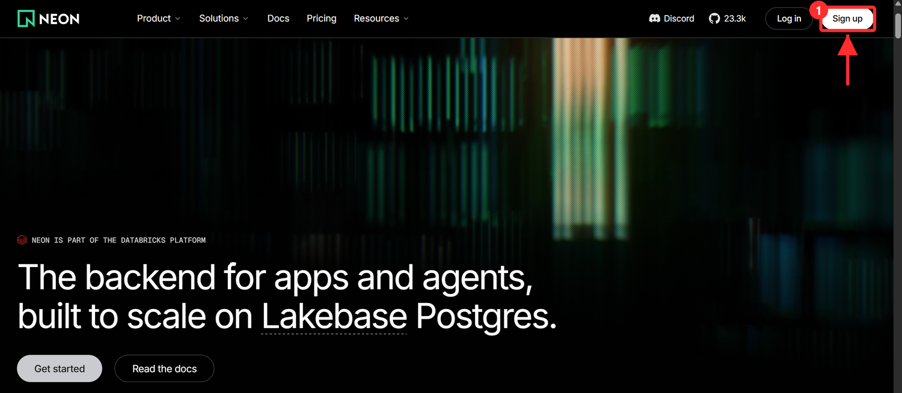
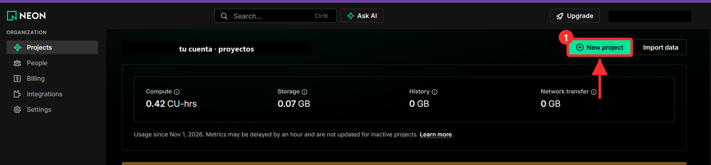
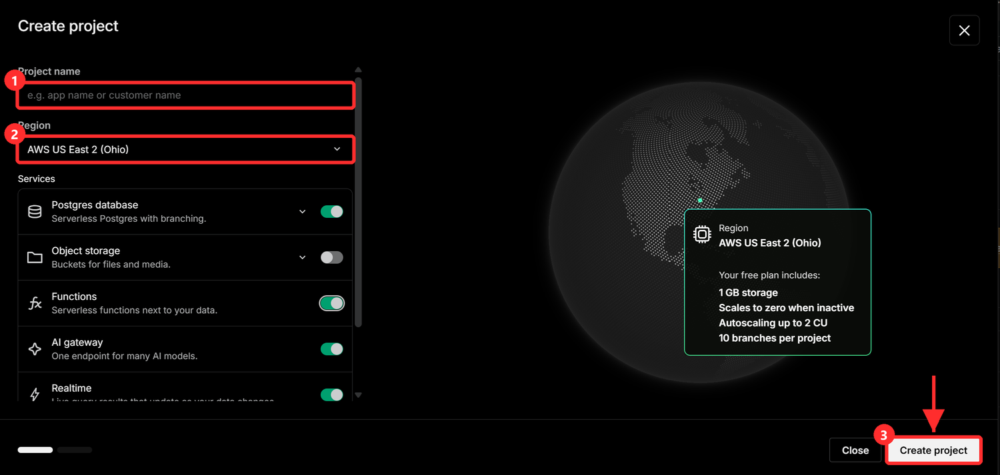
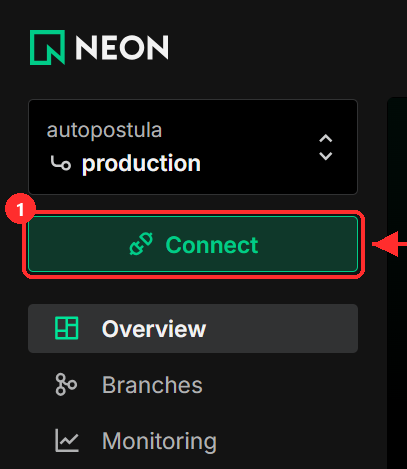
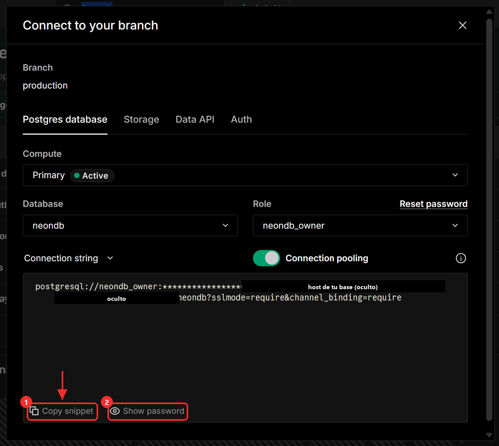
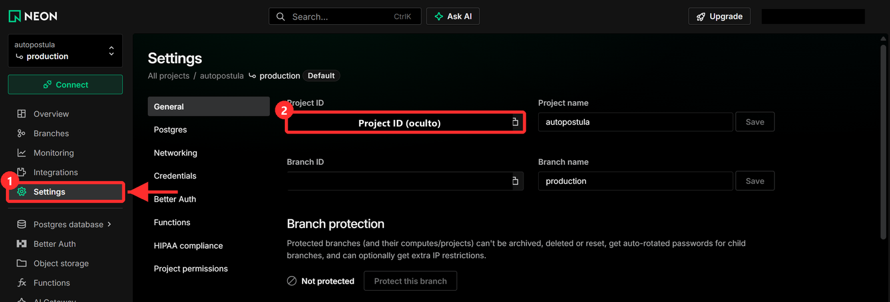

# Neon: tu base de datos

Neon guarda en la nube las ofertas, su estado y los CV. El plan gratuito basta.

## 1. Cuenta y proyecto

1. Entra en **neon.com** y pulsa **Sign up** (con tu cuenta de GitHub o con tu email).

   

2. En **Projects**, pulsa **New project**.

   

3. Rellena el proyecto: **Project name** `autopostula` (1) y la **Region** más cercana a ti (2). Solo hace falta **Postgres database**; el resto de servicios no se usa. Pulsa **Create project** (3).

   

## 2. La cadena de conexión (secreta)

1. Ya dentro del proyecto, pulsa **Connect**.

   

2. Deja **Database** `neondb`, **Role** `neondb_owner` y **Connection pooling** activado. La cadena empieza por `postgresql://`. Pulsa **Show password** (2) y después **Copy snippet** (1): lo que se copia lleva la contraseña.

   

   *(En la captura el servidor está tapado.)*

3. Pégala en tu `.env`, en la línea `NEON_DATABASE_URL=` (Claude te abre el archivo con el Bloc de notas) y guarda. **No la compartas ni la pegues en ningún chat.**

## 3. El Project ID (no es secreto)

1. Abre **Settings** (1) → **General**. El **Project ID** (2) es algo parecido a `palabra-palabra-12345678`.

   

   *(En la captura el identificador está tapado.)*

2. Cópialo y díselo a Claude: va a `neon_project_id` y a `url_consola_neon` de `inputs/mensajes/enlaces.md`.

Claude crea las tablas con `python cli.py instalar`; no tienes que tocar nada más en Neon.
