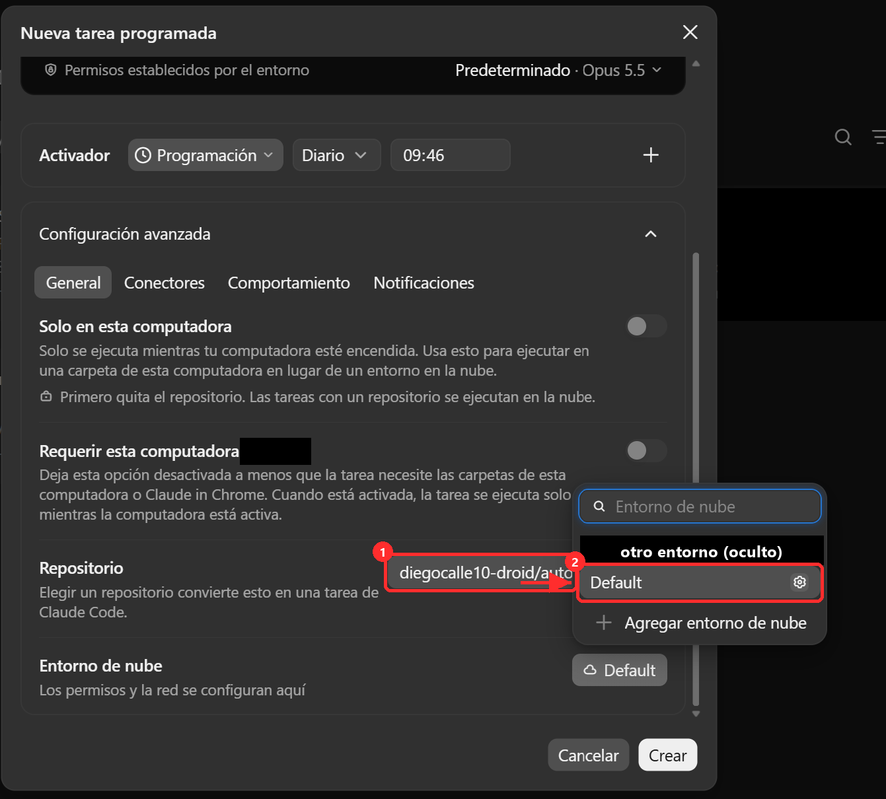
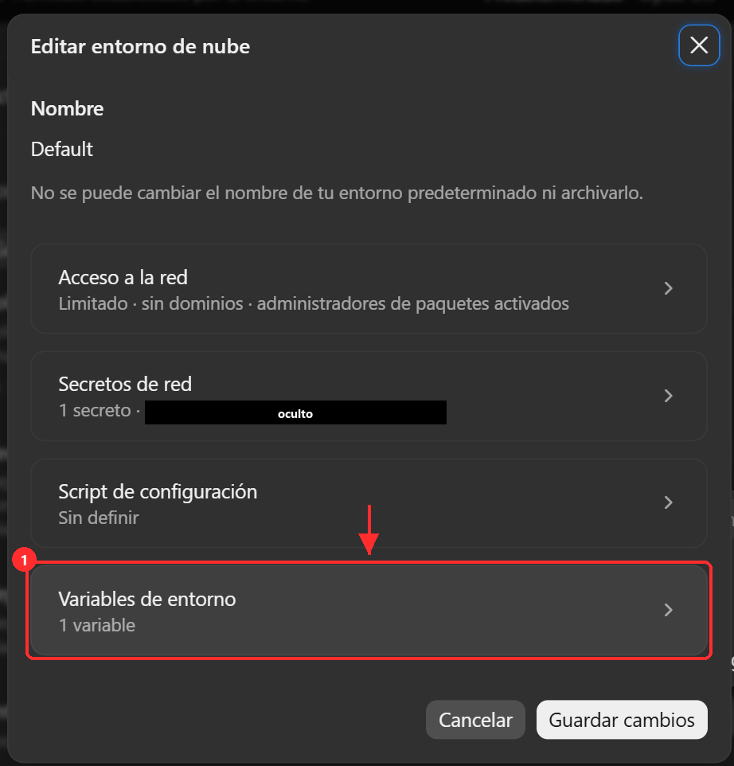
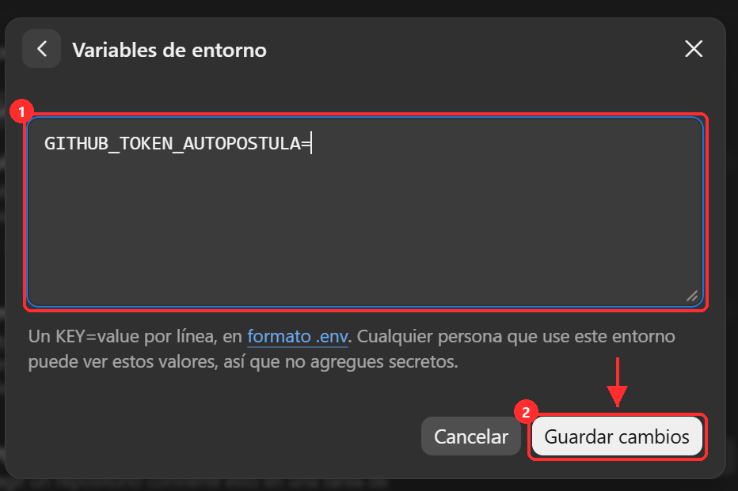
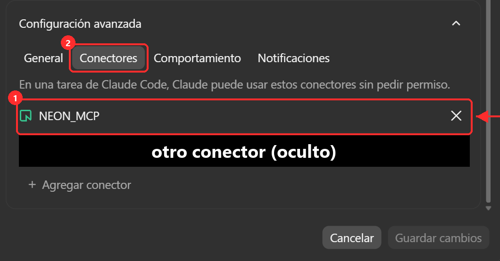

# La rutina de CV (Claude en la nube)

Cada madrugada, a tu `hora_rutina`, Claude abre tu repositorio en la nube, lee tus CV base y las ofertas aptas de Neon, redacta un CV a medida para cada una y avisa a la Action, que te los envía por Telegram. Tu PC puede estar apagado.

Se crea desde la app de escritorio de Claude, en **Programadas**. Antes necesitas el token de GitHub (`guia/github.md`, sección «Token») y el conector de Neon (`guia/conector-neon.md`).

## 1. Nueva tarea

1. En el menú de la izquierda, entra en **Programadas** (1) y pulsa **Nueva tarea** (2).

   

2. Elige **Configurar manualmente**.

   

## 2. Qué hace y cuándo

En el formulario:

1. **Nombre**: `Autopostula · CV a medida`.
2. **Instrucciones**: pega solo la frase de `CV/PROMPT_MINIMO.md`. Las reglas viven en el repositorio; no pegues nada más.
3. **Activador**: **Programación** → **Diario** → la hora de tu `hora_rutina` (la hora es la de tu PC; por ejemplo, 06:00).
4. Abre **Configuración avanzada** y sigue con los pasos de abajo. Cuando termines, pulsa **Crear** (5).


## 3. Repositorio

En **Configuración avanzada** → pestaña **General**:

- **Solo en esta computadora**: desactivado.
- **Requerir esta computadora**: desactivado (así se ejecuta con tu PC apagado).
- **Repositorio**: elige tu repositorio de Autopostula. Al elegirlo, la tarea se ejecuta en la nube.


## 4. Variable con el token de GitHub

1. En **Entorno de nube** (más abajo), con **Default** seleccionado, pulsa el engranaje de **Default** para editarlo.

   

2. En **Editar entorno de nube**, entra en **Variables de entorno**. No hace falta tocar nada más.

   

3. Escribe una línea con el nombre y, tras el `=`, tu token de GitHub, y pulsa **Guardar cambios**:

   ```
   GITHUB_TOKEN_AUTOPOSTULA=<tu token>
   ```

   

   Esas variables las puede ver cualquiera que use ese entorno de nube: es tu cuenta personal, pero no lo compartas con nadie.

## 5. Conector de Neon

En **Configuración avanzada**, pestaña **Conectores** (2), añade `NEON_MCP` (1) con **Agregar conector**. Es el que creaste en `guia/conector-neon.md`.



## 6. Prueba

Pulsa **Crear** y, desde la lista de Programadas, abre la tarea y lánzala una vez a mano (busca su botón de ejecutar ahora). Al terminar debe decir cuántos CV redactó y que la Action respondió `204`; un minuto después te llegan a Telegram.

## El enlace de la rutina (opcional)

`url_rutina`, en `inputs/mensajes/enlaces.md`, es la dirección de la rutina (empieza por `https://claude.ai/code/routines/`). Los mensajes de Telegram la enseñan para que puedas lanzarla a mano con un toque. Para conseguirla, abre la tarea en Programadas y busca la opción de copiar su enlace. Si tu versión de la app no la ofrece, déjalo en `PENDIENTE`: todo funciona igual, solo faltará ese enlace en los mensajes.
