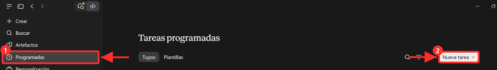
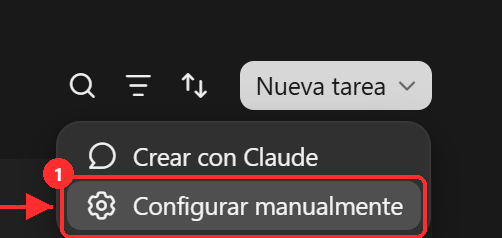
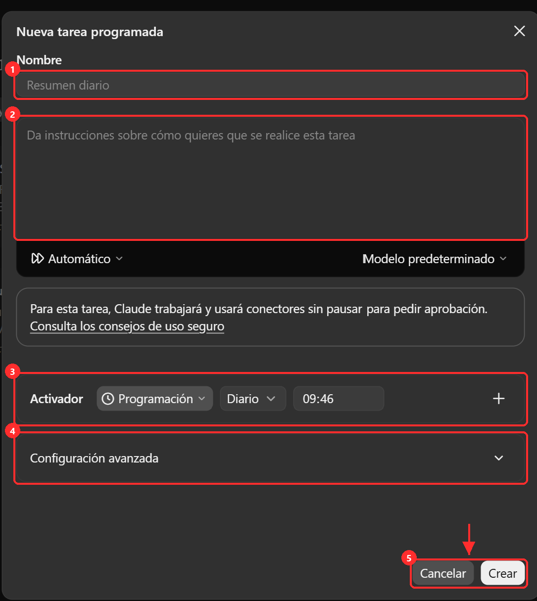
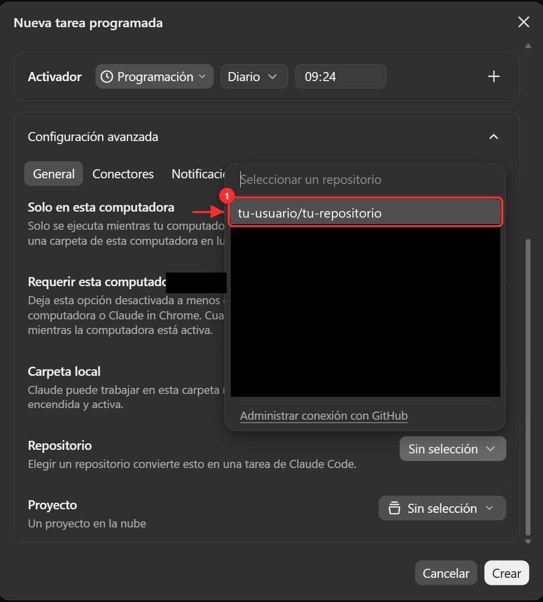

# La rutina de CV (Claude en la nube)

Cada madrugada, a tu `hora_rutina`, Claude abre tu repositorio en la nube, lee tus CV base y las ofertas aptas de Neon, redacta un CV a medida para cada una y avisa a la Action, que te los envía por Telegram. Tu PC puede estar apagado.

Antes: el token de GitHub (`guia/github.md`, sección «Token») y el conector de Neon (`guia/conector-neon.md`).

1. Entra en **claude.ai/code/routines** → **Nueva rutina**.
    *(captura pendiente)*
2. **Repositorio**: el tuyo de Autopostula.
3. **Instrucciones**: copia el bloque de `CV/PROMPT_MINIMO.md` tal cual (una línea que manda leer `CV/PROMPT_RUTINA.md`). No pegues nada más: las reglas viven en el repositorio.
    *(captura pendiente)*
4. **Programación**: todos los días a tu `hora_rutina` (por ejemplo, 06:00).
5. **Entorno** → variables de entorno: añade `GITHUB_TOKEN_AUTOPOSTULA` con el token de GitHub como valor.
    *(captura pendiente)*
6. **Conectores**: activa **Neon**.
7. Guarda. Copia el **enlace de la rutina** (la dirección de su página, `claude.ai/code/routines/...`) y díselo a Claude: va a `url_rutina` y sale en tus mensajes de Telegram para lanzarla a mano cuando quieras.
    *(captura pendiente)*
8. Pruébala con **Run now**: al terminar dice cuántos CV redactó y el código de la Action (`204` es correcto).
