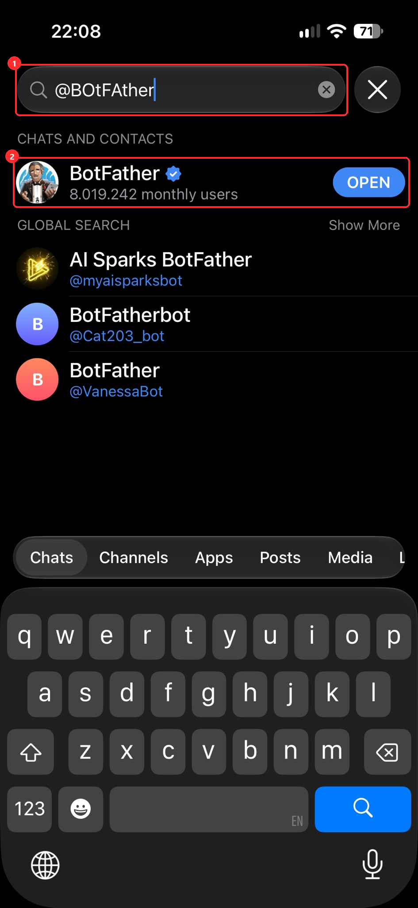
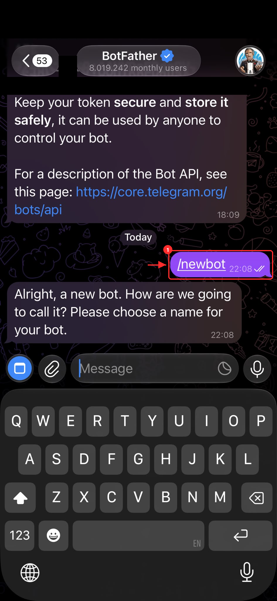
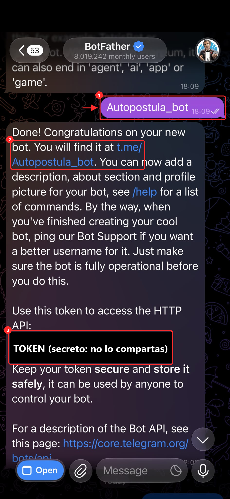

# Telegram: el bot que te envía los CV

Cada mañana te llega un mensaje por oferta, con el CV en PDF y el enlace para postularte. Lo envía un bot tuyo que solo te escribe a ti.

1. En Telegram, busca **@BotFather** (con la marca azul de verificado) y ábrelo con **OPEN**. Ojo con los parecidos que salen debajo, en la búsqueda global.

   

2. Escribe `/newbot` (1). Te pide un **nombre** (el que verás, por ejemplo «Mis CV») y un **usuario** que termine en `bot` (por ejemplo `micv_autopostula_bot`).

   

   *(En la captura el mensaje de arriba, de un bot anterior, está tapado.)*

3. BotFather confirma con «Done!» y te da el **token** (números, dos puntos y letras). Es secreto: cópialo (3), pégalo en tu `.env`, en `TELEGRAM_BOT_TOKEN=`, y guarda. En el mensaje también aparece el enlace a tu bot (`t.me/<usuario>`, 2).

   

   *(En la captura el token está tapado. El tuyo no lo enseñes ni lo pegues en ningún chat.)*

4. Abre el enlace de tu bot, pulsa **Iniciar** y escríbele cualquier cosa («hola»).
5. Claude ejecuta `python cli.py telegram-chat-id`: muestra tu `TELEGRAM_CHAT_ID` y lo pone en el `.env`.

Si alguna vez se te escapa el token: en BotFather escribe `/revoke`, elige tu bot y pon el nuevo token en el `.env` y en los secretos de GitHub.
